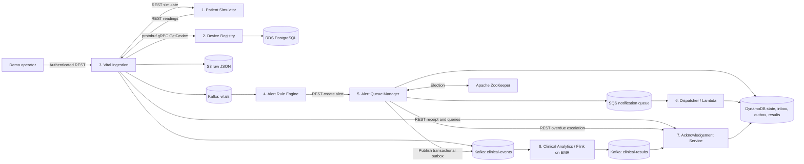
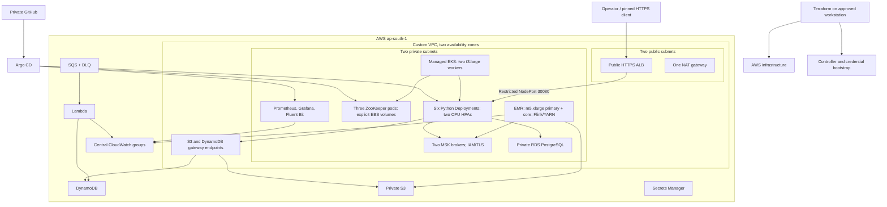
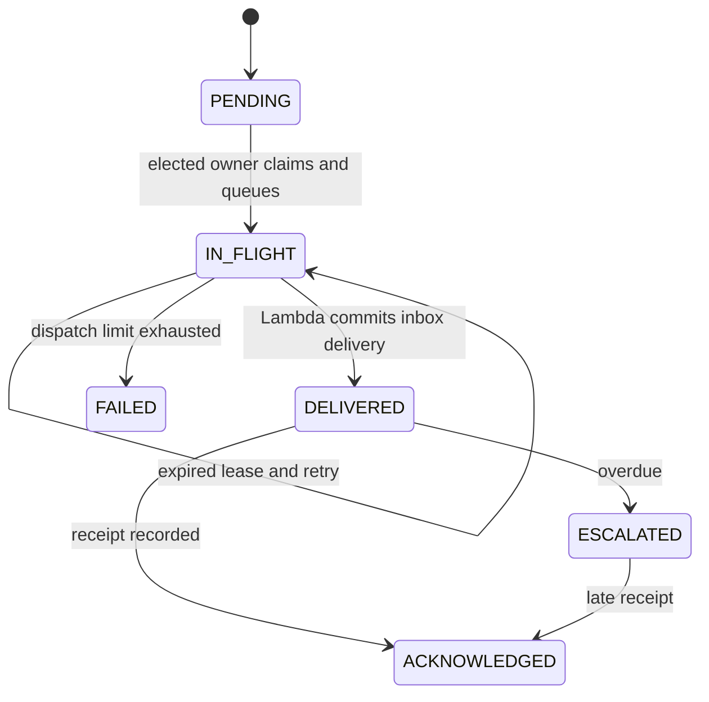

# 3. Design document: S23 synthetic healthcare monitoring

[Requirements](02-requirements-and-evidence.md) | Next: [local walkthrough](04-local-walkthrough.md)

## System overview

S23 demonstrates remote monitoring of **simulated** heart-rate readings:
registration, validation, detection, notification, receipt/escalation and
streaming summaries. It is not a clinical product.

Concept: Apache ZooKeeper applied to application coordination. Cloud:
AWS/ap-south-1. Exactly eight application services: six independent stateless
Python EKS roles, an asynchronous Lambda dispatcher, and Flink on managed EMR.
Infrastructure/helpers do not inflate the service count.

## Microservices and data flow



## Cloud deployment architecture



Terraform owns the ALB/target attachment; no Kubernetes controller silently
creates a second public load balancer. Other application roles remain private.
Public data operations require an API key; landing/health information is open.

## Service responsibilities

| Service | API/worker | Storage/communication |
|---|---|---|
| Patient Simulator | `POST /simulate`, seed and explicit start time | REST into ingestion |
| Device Registry | Device REST and protobuf GetDevice | RDS; IAM login, verified TLS |
| Vital Ingestion | Validates schema, time and registration; public gateway | gRPC, immutable S3 archive, two Kafka publications |
| Alert Rule Engine | `vitals` consumer, demonstration threshold rules | Manager REST, deterministic alert IDs |
| Alert Queue Manager | Alert API and elected scheduling/outbox worker | ZooKeeper, DynamoDB transactions, SQS, Kafka |
| Notification Dispatcher | Lambda SQS handler, partial-batch failures | Atomic delivery, inbox and outbox |
| Acknowledgement Service | Receipt/escalation/query APIs and results consumer | DynamoDB, clinical-results |
| Clinical Analytics | Java Flink Kafka topology | Keyed state, minute windows, S3 checkpoints, result topic |

A reusable Python image avoids duplicate domain/adapter logic, but every EKS
role has its own Deployment/process, identity and service responsibility.

## Data and demonstration rules

Example reading:

```json
{
  "event_id": "example-0",
  "device_id": "device-1",
  "patient_id": "patient-1",
  "heart_rate": 145,
  "observed_at": 1800000000000
}
```

Use current epoch milliseconds live, not that sample date. Readings must be no
older than five minutes or more than one minute in the future. IDs/types/ranges
and registration are validated. The seeded rows are device-1/patient-1 through
device-3/patient-3.

A demo violation is heart rate **below 50 or above 120**; 50/120 are not
violations. These are teaching constants, **not medical advice**.

The standard simulation has 12 unique IDs, seed 7 and one start timestamp;
four readings are abnormal. Identical raw-data retries are retained. Reusing an
ID with different data is rejected before publishing the conflicting reading.

| Storage product | Data |
|---|---|
| S3 | Raw JSON; Flink artifacts/checkpoints; EMR archive |
| RDS PostgreSQL | Device/patient mapping and active flag |
| DynamoDB | Alerts, versions, global fence, outbox, operator inbox, window results |

The work-index supports due work and bounded queries. Window result keys are
stable per device/window end so late updates replace the same summary.
ZooKeeper uses EBS, but the required three-product proof uses S3/RDS/DynamoDB.

## Lifecycle and reliability



AWS acknowledgement timeout is two minutes; local uses one minute. AWS SQS
visibility is 60 seconds, Lambda timeout 10 seconds, dispatch lease 120 seconds.
The lease is longer than first-redelivery visibility.

Alert IDs derive from reading IDs. Optimistic versions reject stale updates.
Each transition and analytics-outbox insertion is a DynamoDB transaction;
delivery also inserts the operator-inbox message in that transaction.

The elected manager publishes outbox events before deletion. A crash can repeat
publication; Flink deduplicates event IDs. SQS/Kafka are at-least-once boundaries.
Current state/version rejects duplicate/stale deliveries with explicit logging.
**No exactly-once external SMS/email delivery is claimed.**

S3 archive and Kafka publication are not one cross-product transaction. A
dependency failure after archive can be retried with identical data within
timestamp bounds. This is a bounded demo, not production exactly-once ingestion.

## Applying ZooKeeper

Two managers join an ephemeral-sequential election under `/s23/escalation`.
The lowest eligible node owns scheduling. Membership is session-bound; suspension
removes authority and reconnection can create a new candidate.

The sequence suffix supplies an increasing term. DynamoDB's global fence rejects
an old owner's dispatch transactions after a newer term becomes active. Alert
versions independently protect queued deliveries.

Demo: record the current owner, fail only that manager pod through Argo CD,
observe a different owner with a higher term, and verify processing continues.
Installing ZooKeeper alone is not enough.

Three members have persistent EBS volumes and parallel startup. They are on two
workers/two AZs to keep the lab smaller: **not three-AZ production HA**. A node
failure can lose two members. Demonstrate manager-pod failure, not deletion of
nodes or all ZooKeeper storage.

The application's own ensemble demonstrates S23; Kafka's internal coordination
is not treated as a substitute.

## Flink analytics

The real job consumes `clinical-events` and:

1. Validates reading/created/delivered/acknowledged/escalated/failed envelopes.
2. Uses five-second out-of-order watermarks and 15-second source idleness.
3. Keys by device; MapState deduplicates IDs with ten-minute TTL.
4. Aggregates one-minute event-time tumbling windows; permits ten seconds lateness.
5. Publishes JSON to the separate `clinical-results` topic.
6. Checkpoints every 60 seconds to S3 in AWS.

Output includes window bounds, reading/creation/delivery/ack/escalation/failure
counts, average heart rate and average ack delay. Missing averages are null.
Watermarks need advancing events; smoke sends normal ticks while waiting.
Too-late events are explicitly logged as dropped. Deduplication is bounded,
not infinite.

Java 17/Flink 1.20.0 matches EMR 7.14.0's documented 1.20.0-amzn-8 family.
Kafka connector/IAM auth and the S3/Prometheus runtime plugins are built separately.

## Scaling and GitOps

Vital Ingestion and Device Registry are critical to every reading. CPU HPAs
target 60%, min one/max three. Small lab CPU requests make real workload-driven
scaling observable; tune from measured idle/load data if necessary, never add
artificial CPU-burning endpoints.

Headless registry DNS and round-robin gRPC let new registry pods receive calls.
k6 sends real validated readings for ten minutes at normally 90 requests/second.
Only 1% are abnormal to avoid intentionally swamping the single elected
scheduler; functional smoke separately exercises four alerts.

Argo CD tracks private Git. Monitoring/metrics-server precede the app; schema and
topics precede services. Environment/IAM checksums roll pods when configuration
changes. HPA-controlled replicas are ignored by Argo to avoid self-healing races.

Terraform bootstraps the controller/credentials. App deployments and updates
remain GitOps-managed; direct apply/scale/Helm upgrade is not an alternative.

## Observability and security

Prometheus/Grafana show HTTP/gRPC/workers, RPS, server-error fraction, p95 latency,
leader count, ready nodes/replicas, HPA replicas, CPU, Lambda and Flink metrics.

Fluent Bit ships all six EKS role logs to CloudWatch. Lambda logs directly and
emits failed-record metrics: partial SQS failures may not increment whole-function
Errors. An EMR CloudWatch agent tails YARN/step logs; confirm actual paths and
collection on the deployed release before claiming full coverage.

Dedicated IAM roles, private SQL/Kafka and network policies restrict access.
No Git-tracked passwords/access keys are used. Internal REST/gRPC are not
advertised as production mTLS. The public ALB uses a DNS-matching self-signed
certificate pinned by the helper; confirm any browser-trusted HTTPS requirement.

## Deliberate limits

- Synthetic heart rate/in-app messages only, no clinical intervention.
- Single-AZ RDS, one NAT and two workers: no production HA claim.
- Ephemeral metric storage; dashboards remain reproducible from Git.
- Cloud logs retain three days; raw readings expire after seven days.
- No node autoscaler; required HPAs scale pods inside fixed capacity.
- No infinite deduplication or cross-product exactly-once claim.
- Moto/Docker do not validate AWS IAM, quotas, managed networking or live scaling.

These simplifications reduce work without replacing the supplied a-h requirements.
